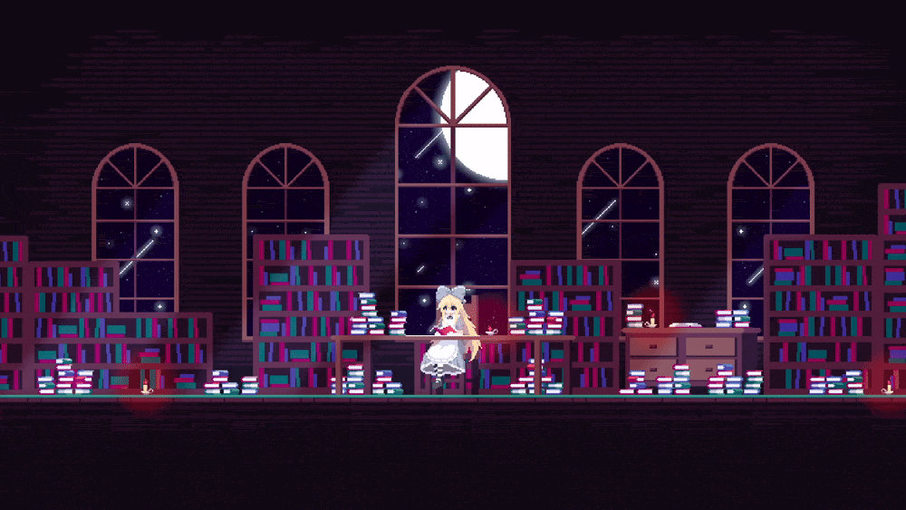

<!-- Header -->

  

<!-- Social Links -->

  

  

  

  

<!-- Hero GIF Banner -->

  

---

### 💫 About Me

I am a passionate **Software Engineer** specializing in building high-performance web applications, resilient backend services, and clean system architectures.

- 🔭 **I’m currently working on:** Scalable web applications & microservices using **.NET & Modern React**.
- 🏛️ **Architectural Focus:** Clean Architecture, Domain-Driven Design (DDD), RESTful APIs.
- 🌱 **I’m currently learning:** Cloud-native architecture, Advanced Distributed Systems & DevOps pipelines.
- 💬 **Ask me about:** C#, .NET Core, React, SQL Server, and Cloud Deployments.
- ⚡ **Fun fact:** I write my best code with a cup of coffee late at night! ☕

---

### 🛠️ Tech Stack & Skills

<table align="center" width="100%">
  <tr>
    <td align="center" width="33%" valign="top">
      <h4>⚙️ Backend & DB</h4>
       
       
       
       
      
    </td>
    <td align="center" width="33%" valign="top">
      <h4>💻 Frontend</h4>
       
       
       
      
    </td>
    <td align="center" width="33%" valign="top">
  <h4>☁️ Cloud & Tools</h4>
   
   
   
   
   
  
</td>
  </tr>
</table>

---

### 📊 GitHub Statistics

  <picture>
    <source media="(prefers-color-scheme: dark)" srcset="https://github-stats-extended.vercel.app/api?username=tungske&show_icons=true&theme=react&hide_border=false&border_color=30363D&bg_color=1F222E&title_color=F85D7F&icon_color=F8D866&text_color=FFFFFF">
    
  </picture>
  &nbsp;&nbsp;

  <picture>
    <source media="(prefers-color-scheme: dark)" srcset="https://github-stats-extended.vercel.app/api/top-langs/?username=tungske&layout=compact&theme=react&hide_border=false&border_color=30363D&bg_color=1F222E&title_color=F85D7F&icon_color=F8D866&text_color=FFFFFF&hide=Jupyter%20Notebook,Roff,HTML,CSS">
    
  </picture>

 

  <picture>
    <source media="(prefers-color-scheme: dark)" srcset="https://github-readme-streak-stats-eight.vercel.app/?user=tungske&theme=react&hide_border=false&border=30363D&background=1F222E&stroke=000000&ring=F8D866&fire=FFC107&currStreakNum=F85D7F&sideNums=F85D7F&currStreakLabel=F85D7F&sideLabels=F85D7F&dates=F8D866">
    
  </picture>

---

### 🎵 My Favorite Song

 
   

